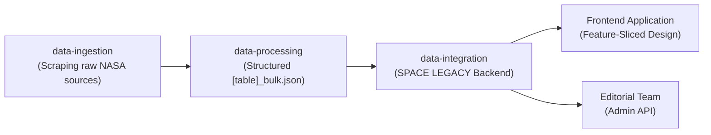
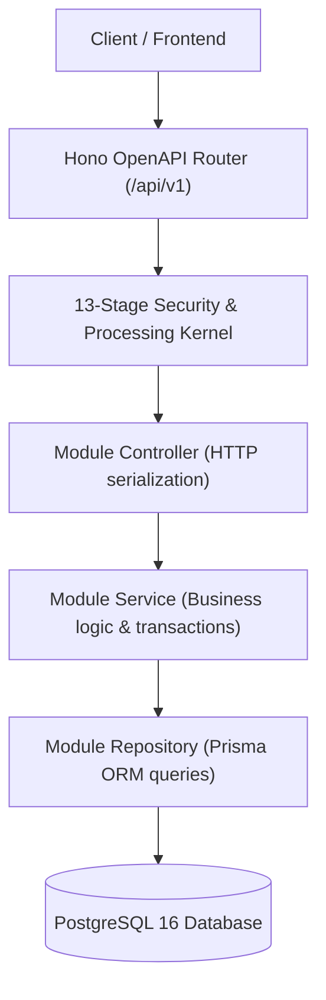

# System Overview & Context

SPACE LEGACY provides an educational API documenting equipment NASA left behind across the Solar System (Moon, Mars, deep space).

## Data Flow & Integration Pipeline

## Modular Monolith Architecture

The backend is built as a single deployable modular monolith structured according to AdonisJS principles:

## Key Invariants

1. **Deny by default**: Unauthenticated requests can only access public GET routes.
2. **Deterministic Data Integrity**: Ingested datasetsupsert deterministically based on natural and UUID v5 keys.
3. **Traceability**: Every published piece of equipment links to authentic NASA sources, archival references, and verified measurements.
