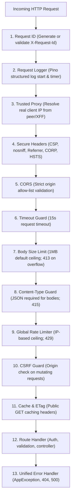

# Request Lifecycle and Middleware Order

Every HTTP request enters the Hono engine and executes through a strictly ordered 13-stage middleware pipeline configured in `start/kernel.ts`.

## The 13 Pipeline Stages

## Security Invariants
- Rate limiting executes before body parsing to protect against volumetric CPU exhaustion.
- Secure headers and `X-Request-Id` are set on every response, including early error exits.
- Trusted proxy verification prevents client IP spoofing via manipulated `X-Forwarded-For` headers.
